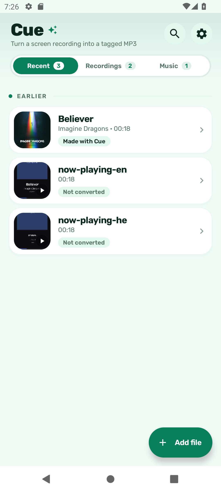
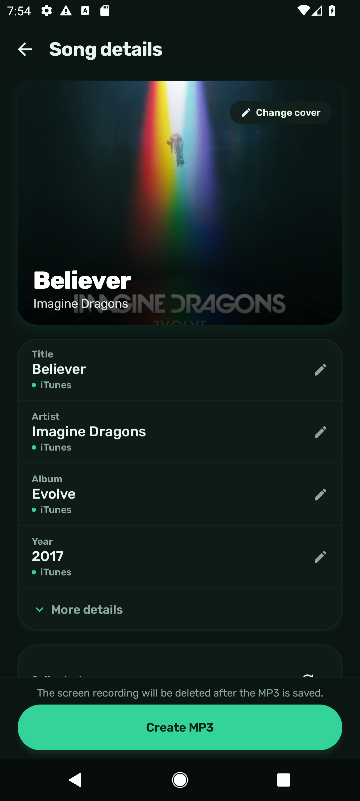
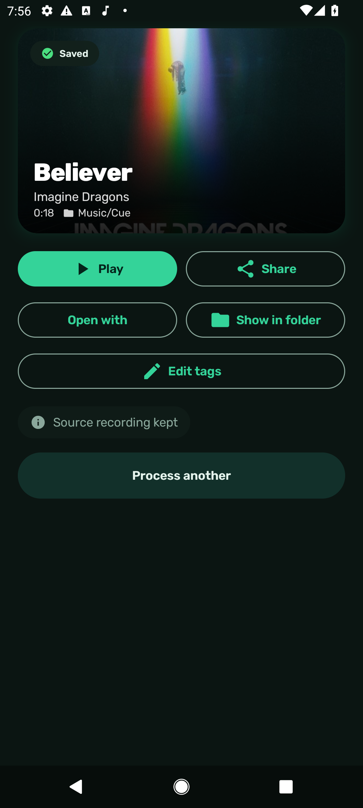
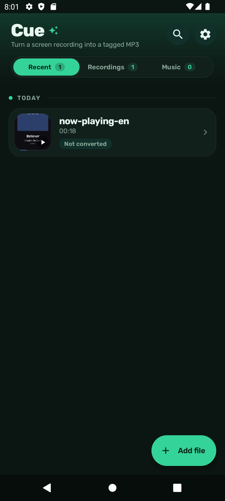

# Cue

Turn a screen recording of a music player into a tagged MP3.

Cue reads the song details off the video's frames, falls back to an audio
fingerprint when there is no readable text, checks the result against online
music databases, and writes an ID3-tagged MP3 you can trim, rename and keep.
It can also edit the tags of an MP3 you already have.

Android 12+, English and Hebrew with full RTL.

---

## What it does

- **Gallery home** — three tabs (Recent, Screen recordings, MP3 music) with
  thumbnails, source chips and day grouping. Tap a recording to start, or an
  MP3 to edit its tags.
- **Song details** — a cover hero, compact editable fields, per-field source
  badges, and a "Check this" flag when a lookup is plausible but not certain.
  Fix any field inline; a low-confidence match never silently becomes a tag.
- **Identification** — ML Kit and Tesseract OCR over sampled frames, script
  detection so Hebrew is not forced onto English text, Chromaprint fingerprints
  through AcoustID, ACRCloud for clips that start mid-song, then iTunes and
  MusicBrainz lookups. If a scan picks the wrong script, "Re-run text scan"
  re-reads the frames automatically or as English or Hebrew text.
- **Track details** — after a confident match, Cue fills in lyrics (LRCLIB),
  BPM, ReplayGain and ISRC (Deezer) and the MusicBrainz IDs. Only empty fields
  are filled; a failure never blocks the save.
- **Cover art** — the confident match's artwork is applied automatically; you
  can search online, pick an image, or remove it.
- **Clip and quality** — typed `m:ss` trim bounds, quality presets with a size
  estimate, and a preview player.
- **Processing** — a foreground service converts with FFmpeg and shows a staged
  progress ring; cancel at any point.
- **Saved** — play, share, open with, edit tags, or process another. The saved
  file is read back through MediaStore and its tags compared with the draft
  before anything else happens.
- **Delete the source recording** — on by default for videos, and only after
  the MP3 is saved and verified. Cue asks first, then Android's own delete
  dialog asks again; dismissing it keeps the recording and says so.
- **Four themes** — Mint, Lagoon, Navy and Deep teal, each with a light and a
  dark scheme, switched instantly from Settings.

## Screenshots

| Home | Song details |
|---|---|
|  |  |

| Saved | Home in dark mode |
|---|---|
|  |  |

Captured on a 1080 × 2400 API 31 emulator, Mint palette, light and dark.

## Requirements

- JDK 17+ (the project builds with 21).
- Android SDK with platform 35. `local.properties` must point at it
  (`sdk.dir=...`).
- The native FFmpeg libraries are already in `app/src/main/jniLibs` for
  `arm64-v8a` and `x86_64`; `scripts/native/build.cmd` rebuilds them.

## Build and install

```powershell
# Windows
.\gradlew.bat assembleDebug
adb install -r app\build\outputs\apk\debug\app-debug.apk
```

```bash
# macOS / Linux
./gradlew assembleDebug
adb install -r app/build/outputs/apk/debug/app-debug.apk
```

## Tests

```bash
./gradlew testDebugUnitTest lintDebug
```

Unit tests run on the JVM with Robolectric for the Android-dependent pieces;
there are no instrumentation tests.

## AcoustID key

Fingerprint lookup needs a free application key from
[acoustid.org/new-application](https://acoustid.org/new-application).

The key is **never committed**. Put it in the untracked `local.properties`:

```properties
acoustid.apiKey=your-key-here
```

That value becomes the build-time default (`BuildConfig.ACOUSTID_API_KEY`).
The field in Settings wins once you save it there. If AcoustID rejects the key,
the review screen says so and links straight to Settings.

## ACRCloud credentials

AcoustID fingerprints the whole file, so it cannot match a recording that
starts in the middle of a song. ACRCloud matches a 12-second fragment from the
middle of the recording instead, which covers that case. Create a free project
at [acrcloud.com](https://www.acrcloud.com/) and copy the host, access key and
access secret from its console.

They are **never committed**. Put them in the untracked `local.properties`
next to the AcoustID key:

```properties
acrcloud.host=identify-eu-west-1.acrcloud.com
acrcloud.accessKey=your-access-key
acrcloud.accessSecret=your-access-secret
```

The three fields in Settings win once you save them there, and "Check key"
uploads a generated silent probe: any answer other than an auth or quota error
means the credentials are accepted. Without credentials the stage is skipped
and the app behaves as before.

## Track details

Once a match is confident, Cue fills the blanks in the review draft from two
public services, in parallel:

| Field | Source |
|---|---|
| Lyrics | [LRCLIB](https://lrclib.net/) |
| BPM, ReplayGain, ISRC | [Deezer](https://developers.deezer.com/api) |
| Recording, release and artist MBIDs | MusicBrainz (via the text lookup) |

Nothing you typed is replaced, and an offline or failing service simply leaves
the field empty. The review screen shows each filled value with its source and
offers a manual lyrics fetch.

## Project layout

| Path | What lives there |
|---|---|
| `app/src/main/java/io/github/rpn17m2g/cue/domain/` | Pure logic: OCR candidate ranking, identification cascade, confidence tiers, trim math, tag diffs |
| `.../data/` | MediaStore gallery and output, input resolution, artwork, metadata clients, fingerprint, OCR engine adapters |
| `.../processing/` | The foreground service, job codec, and the save → verify → delete pipeline |
| `.../tags/` | ID3 read/write through mp3agic |
| `.../audio/` | FFmpeg command building, probing, progress parsing |
| `.../ui/` | Compose screens, navigation, and the theme system (`ui/theme/`) |
| `docs/` | Design plan, implementation phases, standards, ADRs |
| `design/` | HTML mockups plus the on-device screenshots the UI was verified against |

## Documentation

- [`docs/PLAN.md`](docs/PLAN.md) — the design and its decisions.
- [`docs/PHASES.md`](docs/PHASES.md) — implementation phases.
- [`docs/UI-REDESIGN-PLAN.md`](docs/UI-REDESIGN-PLAN.md) — the current UI
  redesign, palettes and the functional work folded into it.
- [`docs/STANDARDS.md`](docs/STANDARDS.md) — coding standards.
- [`docs/ADR/`](docs/ADR) — architecture decision records.

## License

MIT. See [`LICENSE`](LICENSE).
